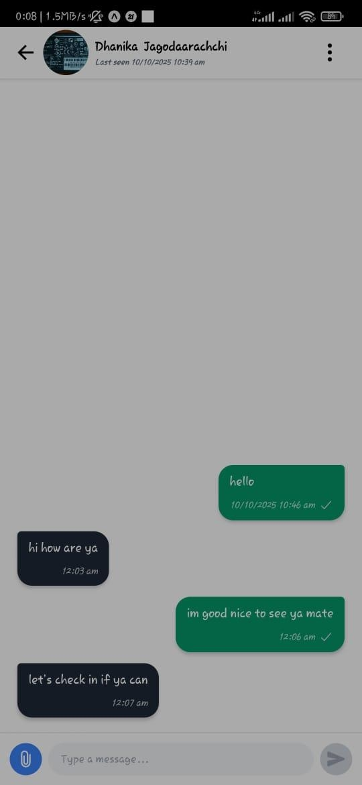
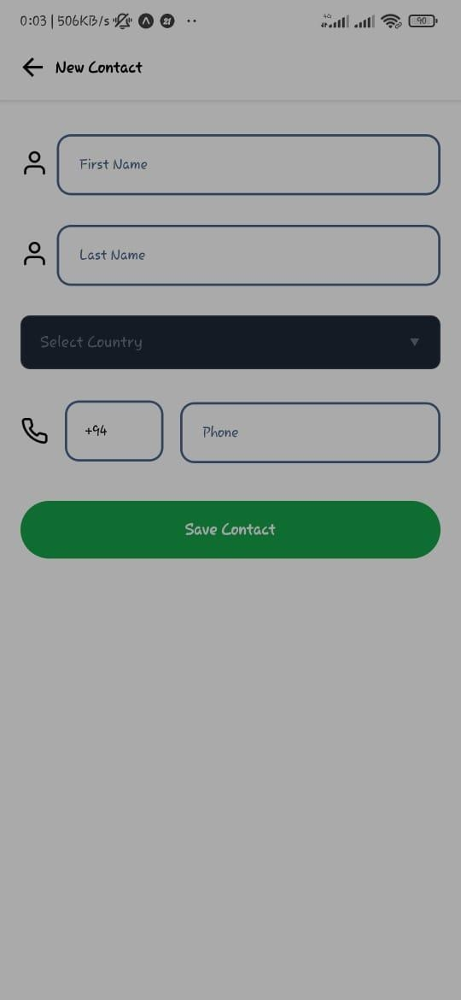
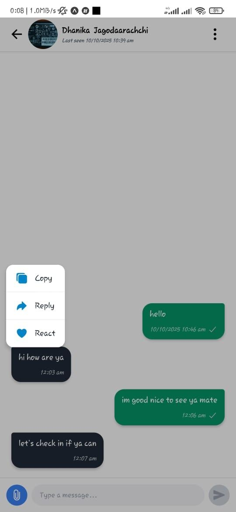
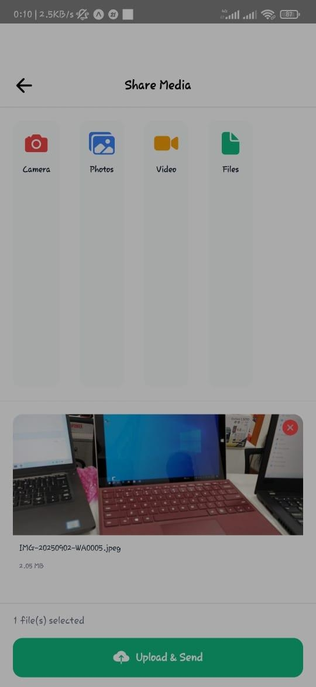

# LinkUp

**LinkUp** is a cross-platform mobile application built with React Native and supported by a dedicated backend API. It provides a modern mobile interface for user registration, profile management, social connection, and interaction with platform content through a secure client–server architecture.

[](https://opensource.org/licenses/MIT)
[](https://reactnative.dev/)
[](https://developer.mozilla.org/en-US/docs/Web/JavaScript)
[](https://developer.android.com/)
[](https://developer.apple.com/ios/)

## Backend Repository

This frontend depends on the LinkUp backend service:

**Backend:** [DhanikaJ/LinkUp-Backend](https://github.com/DhanikaJ/LinkUp-Backend)

The mobile application communicates with the backend through HTTP-based API requests. The backend must be running and correctly configured before authentication and data-dependent features will function.

## Overview

LinkUp follows a cross-origin, full-stack architecture in which the React Native frontend and backend API are maintained as separate repositories. This separation allows the mobile interface, API logic, database schema, and deployment process to evolve independently.

The frontend is responsible for user interaction, navigation, form handling, and presentation. The backend handles authentication, authorization, data validation, business rules, and persistent storage.

## Features

### Mobile Application

- Cross-platform support for Android and iOS
- User registration and login interface
- Profile creation and management
- Secure API-based communication
- Navigation between application screens
- Form validation and user feedback
- Responsive mobile-first user interface

### Backend-Integrated Features

- Authentication and session management
- User profile data retrieval and updates
- Connection or interaction management
- Content and activity retrieval
- Centralized business logic and data persistence

## System Architecture

```text
LinkUp React Native Application
              │
              ▼
       HTTP / REST API
              │
              ▼
LinkUp Backend Service
              │
              ├── Authentication Layer
              ├── Business Logic Layer
              ├── Data Access Layer
              └── Database
```

## Screenshots

Screenshots are stored in the frontend repository under `assets/img/`.

|Splash Screen | Home Screen | Chat Screen |
|---|---|---| 
|  |  |  |
| Profile Screen | Add new friend Screen | longPress Screen |
|  |  |  |
|  |  |  |

## Technology Stack

| Layer | Technology |
|---|---|
| Mobile framework | React Native |
| Programming language | JavaScript |
| Platforms | Android and iOS |
| Navigation | React Navigation |
| API communication | Fetch API or Axios |
| State management | React state / Context API |
| Backend | LinkUp Backend REST API |
| Version control | Git and GitHub |
| License | MIT License |

## Project Structure

```text
LinkUp/
├── assets/
│   └── img/                # Application screenshots and image assets
├── src/
│   ├── components/         # Reusable UI components
│   ├── screens/            # Application screens
│   ├── navigation/         # Navigation configuration
│   ├── services/           # API service layer
│   ├── context/            # Global state and authentication context
│   ├── utils/              # Helper functions
│   └── App.js              # Root application component
├── .env                    # Local environment configuration
├── package.json            # Dependencies and scripts
└── README.md               # Project documentation
```

## Prerequisites

Install the following before running the project:

- Node.js 18 or later
- npm or yarn
- React Native CLI or Expo CLI, depending on the project setup
- Android Studio for Android emulation
- Xcode and CocoaPods for iOS development on macOS
- A physical device or emulator

## Installation

Clone the frontend repository:

```bash
git clone [https://github.com/DhanikaJ/LinkUp.git](https://github.com/DhanikaJ/LinkUp.git)
cd LinkUp
```

Install dependencies:

```bash
npm install
```

## Backend Connection

Create a `.env` file in the frontend root directory:

```env
API_BASE_URL=http://localhost:5000/api
```

If testing on a physical Android device, replace `localhost` with your computer’s local network IP address:

```env
API_BASE_URL=http://192.168.1.10:5000/api
```

For a deployed backend:

```env
API_BASE_URL=[https://your-backend-domain.com/api](https://your-backend-domain.com/api)
```

## Running the Application

### Android

```bash
npm run android
```

### iOS

```bash
cd ios
pod install
cd ..
npm run ios
```

### Metro Bundler

Start the Metro development server manually:

```bash
npm start
```

## Full-Stack Local Workflow

1. Clone and start the backend:

   ```bash
   git clone https://github.com/DhanikaJ/LinkUp-Backend.git
   cd LinkUp-Backend
   npm install
   npm run dev
   ```

2. Clone and start the frontend:

   ```bash
   git clone https://github.com/DhanikaJ/LinkUp.git
   cd LinkUp
   npm install
   npm run android
   ```

3. Set `API_BASE_URL` in the frontend `.env` file.

4. Register or log in through the mobile application.

5. Verify that profile and application data load from the backend.

## API Integration

The frontend communicates with the backend using JSON-based REST APIs.

Example authenticated request:

```javascript
const response = await fetch(`${API_BASE_URL}/users/profile`, {
  method: "GET",
  headers: {
    "Content-Type": "application/json",
    Authorization: `Bearer ${token}`,
  },
});

if (!response.ok) {
  throw new Error("Failed to load profile");
}

const data = await response.json();
```

## Cross-Origin Communication

LinkUp uses a cross-origin architecture: the React Native client and backend API are separate applications and repositories. During development, the frontend must be configured with the correct backend origin, while the backend must permit requests from the frontend origin.

For browser-based testing or web builds, configure CORS on the backend:

```javascript
const cors = require("cors");

app.use(
  cors({
    origin: process.env.CORS_ORIGIN,
    credentials: true,
  })
);
```

Native Android and iOS applications generally communicate directly with the API, but CORS configuration remains necessary for web clients, debugging tools, and future web deployments.

## Security Considerations

- Store authentication tokens securely on the device.
- Avoid committing API keys, secrets, or credentials to version control.
- Validate all user input before sending it to the backend.
- Handle expired tokens and unauthorized API responses gracefully.
- Use HTTPS for all production API communication.
- Restrict sensitive operations to authenticated users.
- Keep React Native and npm dependencies updated.

## Future Enhancements

- Push notifications
- Offline support and local caching
- Image and media uploads
- Real-time messaging or activity updates
- Search and discovery features
- Dark mode support
- Biometric authentication
- Automated component and integration testing
- CI/CD pipeline for Android and iOS builds

## Contributing

1. Fork the repository.
2. Create a feature branch:

   ```bash
   git checkout -b feature/your-feature-name
   ```

3. Commit your changes:

   ```bash
   git commit -m "feat: improve profile screen"
   ```

4. Push the branch:

   ```bash
   git push origin feature/your-feature-name
   ```

5. Open a pull request.

## License

This project is licensed under the MIT License. See the [LICENSE](LICENSE) file for details.

## Author

**DhanikaJ**  
GitHub: [https://github.com/DhanikaJ](https://github.com/DhanikaJ)
